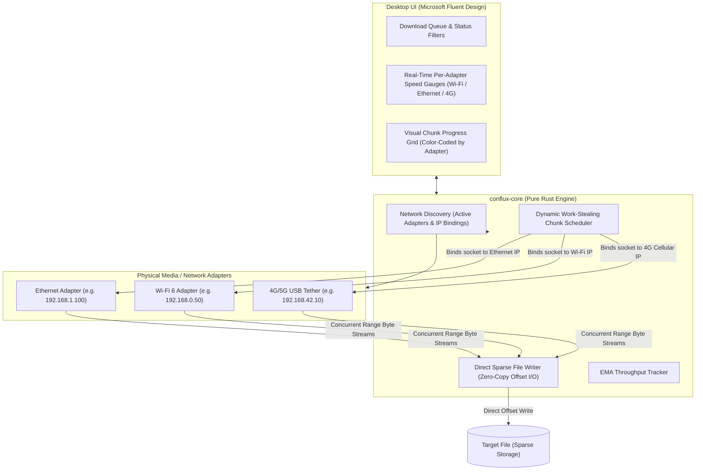
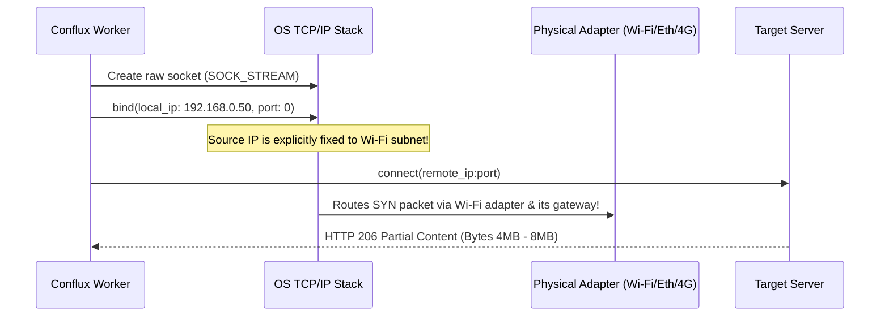

# Conflux: Architecture & Channel Bonding Deep Dive

## Desktop UI boundaries

The React UI groups download, network, and settings code under `ui/src/features/`.
Feature components own presentation; hooks own React state and event subscriptions.
Download starts run through `StartDownloadUseCase`, and serialized settings saves run
through `UpdateSettingsUseCase`. Both use repository interfaces returning `Result`;
the adapters in each feature's `api/` directory translate throwing Tauri commands to
that contract. The application layer preserves browser headers and handoff IDs and
strips adapter overrides from general settings saves, since adapter toggles own them.

`useAddDownload` owns the keyed dialog's form state, origin checks, debounced probes,
and submission. Advancing the request key resets the form; arrivals in the queue do
not reset edits. Cancelled probes cannot replace the current URL's preview, and
browser session headers follow only URLs sharing the original origin.

Shared controls live under `ui/src/components/ui/`. Components, hooks, and IPC types are imported directly from their owning
modules. Forwarding-only entry points and feature barrels are removed; shared shell
icon lookup invokes its native command directly. Event names live in `ui/src/utils/events.constants.ts` and retain
the native `external-download` and `history-save-status` contracts. Tests load the
production feature sources and verify those names against the Rust emitters.

### App composition

`App.tsx` composes the features and keeps the navigation and selection shared by
navigation, download starts, and the active view. `app/AppShell.tsx` owns the themed
window layout, navigation panel, status bar, and toaster. Download categories share
the same view key so changing categories does not remount the table.

Application hooks own global behavior: `useAppNotifications` handles startup and
update toasts through `AppToast`; `useDesktopEvents` owns native subscriptions and
cleanup; `useAppShortcuts` owns keyboard and clipboard listeners. Download-specific
state stays with the feature: `useDownloadList` owns filtering, sorting, counts and
details visibility, while `useDownloadDialogs` owns the handoff queue and modal
exclusion. Its synchronous refs prevent consecutive browser requests from replacing
the active form, and request identities reject stale completion callbacks.

## System Overview



---

## 1. The Single-Gateway Bottleneck in Standard Operating Systems

In Windows (and most other operating systems), when an application initiates an outgoing TCP connection using a default socket (`INADDR_ANY`), the OS kernel consults the system IP routing table:

```text
Destination     Gateway         Netmask         Interface       Metric
0.0.0.0         192.168.1.1     0.0.0.0         192.168.1.100   25  (Ethernet)
0.0.0.0         192.168.0.1     0.0.0.0         192.168.0.50    35  (Wi-Fi 6)
0.0.0.0         192.168.42.1    0.0.0.0         192.168.42.10   45  (4G USB Tether)
```

By default, the kernel always selects the route with the **lowest metric** (Ethernet with metric 25).
- Result: **100% of download traffic flows through Ethernet**. Active Wi-Fi and 4G USB tethering connections remain **0% utilized**.

---

## 2. The Conflux Channel Bonding Mechanism

Conflux breaks this limitation by performing **explicit local IP socket binding**:



### The Rust Implementation
In `crates/conflux-core/src/adapter.rs`, `build_bound_http_client(local_ip, interface, stall_timeout)`:
```rust
let mut builder = reqwest::Client::builder()
    .connect_timeout(CONNECT_TIMEOUT)
    .read_timeout(stall_timeout);
if let Some(ip) = local_ip {
    builder = builder.local_address(Some(ip));      // bind the source IP
}
#[cfg(target_os = "linux")]
if let Some(name) = interface.filter(|n| !n.is_empty()) {
    builder = builder.interface(name);              // SO_BINDTODEVICE
}
```

Windows is the only supported platform; the Linux code paths below exist only so the core
tests run on the WSL2 dev host.

Binding the source IP alone does not pin the egress interface on weak-host-model stacks
(Linux by default): the kernel may still route out of another NIC carrying this NIC's
source address. On **Linux** (dev/test only) the engine therefore also passes the OS interface name
(`BindTarget::interface` in `engine.rs`, taken from `NetworkAdapter::name`), which sets
`SO_BINDTODEVICE`. On **Windows** only the source-IP bind is used (the `interface`
argument is ignored), so true per-adapter egress there depends on the routing table and is
still to be verified on real hardware.

---

---

## 3. Work-Stealing Chunk Scheduling Algorithm

Conflux partitions the target file into dynamic chunks (e.g. 4 MB default):

```text
[ Chunk 0: 0 - 4MB ]   [ Chunk 1: 4MB - 8MB ]   [ Chunk 2: 8MB - 12MB ] ...
```

### Dynamic Work-Stealing Protocol:
1. An asynchronous pool of worker threads is spawned for each active network interface (e.g. 4 workers on Ethernet, 4 on Wi-Fi, 4 on 4G).
2. As soon as any worker becomes idle, it atomically claims the next `Pending` chunk from the work-stealing queue.
3. **Automatic Bandwidth Balancing**:
   - A 100 Mbps Ethernet connection will finish and claim 4 chunks in the time a 25 Mbps connection claims 1 chunk.
   - Bandwidth aggregation is naturally self-balancing without complex static partitioning.
4. **Tail recovery**:
   - Active segments publish a time-weighted rolling speed every 500 ms with a 3-second decay constant, including samples with no incoming bytes.
   - Once no pending ranges remain, an idle worker can steal as little as one block (including a partial final block), provided splitting saves at least one second. The victim keeps the lower range and its live upper bound shrinks, preserving a single writer per byte.
   - A stream silent for ten seconds is retried through the existing failure path only if another stream on the same adapter received data within the last three seconds. Buffered data is flushed first and completed blocks are retained. Time spent waiting on a disk write does not count as network silence.
   - Splits occur only at block boundaries. A victim's final partial block that continues trickling must still finish on that connection; the silence rule does not cancel a stream that keeps receiving data.
5. **Fault-Tolerant Failover**:
   - If an adapter drops (e.g. Wi-Fi disconnection or socket timeout), the worker catches the error, marks the chunk status back to `Pending`, and logs the failure.
   - Surviving workers on the remaining adapters automatically steal the uncompleted chunk and download it without corrupting the file or interrupting the download.

---

### Desktop staging and completion

New desktop tasks write to `<filename>.part`, with resume data under
`%APPDATA%\com.conflux.desktop\resume\<path-hash>.json`. The full output path is
hashed so equal filenames in different folders have separate resume records. Existing
`<filename>.part.conflux.json` sidecars remain readable and are removed only after resume
data is persisted in app data. No new resume JSON files are written to download folders.
The displayed filename keeps the intended final name;
`save_path` records the physical file and `final_path` records the intended completed path.
Legacy tasks without `final_path` continue at their recorded paths, including real files
whose names end in `.part`.

After the engine syncs and hashes the file, the desktop writes Mark-of-the-Web to the
partial file and records the hash and publish destination in history before renaming.
The Windows rename uses an identity-checked handle and does not replace a destination.
Collisions select a new numbered filename; scanner sharing/access errors retry for about
four seconds. A failed publish keeps the completed `.part` file, and Resume verifies its
hash and retries publishing without a network request. If the app exits after renaming
but before recording completion, history loading recognizes the final file by identity.
History format 2 records this intent; older history formats remain readable.

The task becomes Completed only after publication succeeds. Open is limited to completed
tasks; Show in folder and Copy file path refer to the current physical path.

## 4. Zero-Copy Sparse File Pre-Allocation

Traditional download managers often download separate `.part` files for each connection and concatenate them together at the end, causing heavy disk thrashing and high completion latency on large files (e.g. 50 GB games).

Conflux uses **sparse file pre-allocation**:
1. When the download initializes, `SparseFileWriter::create` (`writer.rs`) pre-allocates the complete target file size instantly:
   - On Windows: first marks the file sparse (`FSCTL_SET_SPARSE`, best effort, in `mark_sparse`), then `set_len` moves `EndOfFile`. Without the sparse flag NTFS zero-fills everything before a far-offset write.
   - On Linux (dev/test only): `set_len` (`ftruncate`) leaves a sparse file.
   - `SparseFileWriter::open_existing` reopens a partial file for resume without truncating it.
2. Workers write incoming stream buffers **directly to their exact byte offsets**:
   ```rust
   writer.write_at(chunk.start + stream_offset, &bytes).await?;
   ```
3. Chunks can arrive in any order (e.g. Chunk 7 finishes before Chunk 2). They are written to their respective disk positions with zero intermediate merging.
4. Once all chunks are marked `Completed`, `writer.sync()` flushes the OS file buffers 

---

## 5. Adapter Discovery, Link State and the Watcher

- **Discovery** (`discover_adapters` in `adapter.rs`) lists interface addresses and classifies each as enabled/disabled (loopback, link-local, IPv6 and virtual/VPN/bridge adapters are listed but disabled by default; Hyper-V `vEthernet` external switches carrying a default gateway are treated as physical uplinks and enabled, while internal/host-only switches remain filtered).
- **Link-state filtering**: only adapters that can carry traffic are reported. On Linux the interface must have `IFF_UP` and `IFF_RUNNING` (`is_linux_interface_operational`; an unplugged cable keeps its static IP but loses RUNNING). On Windows the adapter's `OperStatus` must be Up and the address must have passed duplicate address detection, i.e. DAD state Preferred (`is_windows_address_operational`). The Windows path is compiled but not yet run on a real host.
- **Watcher** (`watcher.rs`, `NetworkWatcher`): OS notifications (`NotifyUnicastIpAddressChange` on Windows, a `NETLINK_ROUTE` socket on Linux) trigger a debounced rescan; `diff_adapters` turns the result into add/remove/toggle changes published on a `tokio::sync::watch` channel. The OS listener is registered **before** the first scan so a change between the two is never lost. If registration fails or the listener dies, a fallback poller rescans every `FALLBACK_POLL_INTERVAL` (5 s). It must be started inside a Tokio runtime (the desktop app does this in `lib.rs` setup).
- **Adapter overrides** (`settings.rs`, `adapters.rs`): the user's enable/disable choices are stored in `Settings::adapter_overrides` keyed by **interface name**, so they survive DHCP address changes. Older settings used `"<name>:<ip>"` keys; `Settings::normalized` runs `adapters::migrate_overrides` on load (an existing plain-name key wins; the result is idempotent). `commands::set_override` writes the name key and drops legacy keys for that name; `apply_overrides` still honours a legacy key only when no name key exists.

## 6. Engine Resilience (`engine.rs`)

- **Resume validation**: parallel transfers require range support, a known size and a syntactically valid strong ETag. Every ranged request sends that ETag in `If-Range` and requires the same ETag in its 206 response. Missing secondary Last-Modified headers are accepted; conflicting supplied values are rejected. Weak/missing ETags and lost range support use a fresh complete single stream, never old completed blocks. Sidecars bind saved blocks to a hash of the resource URL and the output file identity; signed URLs are not newly stored there. Unsplit responses must reach verified EOF before committing their final blocks.
- **IPv6 family filtering**: bound workers are constrained to the bound adapter's IP family via a custom DNS resolver (`FamilyFilteredResolver`). IPv4-bound workers resolve and connect exclusively to IPv4 addresses, preventing dual-stack CDN endpoints from silently routing traffic out the default gateway via IPv6 `[::]:0`.
- **Request privacy**: automatic redirect Referer generation is disabled. Explicit browser context is preserved, and cookies are stripped across origins. Resume restores permitted Referer/User-Agent before probing, using the saved original authorization origin even when the initial request redirected.
- **Ephemeral session cookies**: authenticated downloads received from browser extension handoffs use cookies only in-memory; cookies are never persisted to disk in the app-data resume metadata to protect user credentials. Resuming an authenticated download where the session has expired or requires cookies prompts a clean re-handoff.
- **Disk error distinction**: chunk write failures (disk full `ENOSPC` or access denied) are returned as `AttemptError::Disk(io::Error)`. This terminates the download immediately without wasting retry cycles or dropping healthy network adapters.
- **Prompt worker retirement**: when an adapter reaches `MAX_CONSECUTIVE_ADAPTER_FAILURES`, `adapter.retire_tx` is signaled immediately, causing sibling workers on that adapter to release locked chunks promptly without stalling for the 20-second timeout.
- **Last-usable-adapter guard**: after `MAX_CONSECUTIVE_ADAPTER_FAILURES` (3) failures an adapter is dropped for this download, but never if it is the last live one; the per-chunk budget (`MAX_CHUNK_ATTEMPTS`, 5) then decides. Drop decisions take the `adapter_states` write lock so concurrent workers take turns.
- **Default-route fallback**: if no usable adapter remains (or none was selected), an unbound client (`BindTarget { ip: None }`) uses the OS default route. When a new explicit adapter joins, the fallback is retired (`retire_default_route`) only after that adapter completes a chunk, so a flaky new adapter cannot strand the download.
- **File ownership**: tasks record identity from the exact `create_new` handle and persist it in history. Windows deletion validates identity under an exclusive handle and uses file disposition on that handle, preventing pathname replacement during deletion. Sidecar presence and file length are never ownership evidence. Missing outputs are reclaimed with `create_new`; replacement or legacy files with unknown identity are preserved. The desktop passes the claimed identity to the engine (`expected_identity` on `download_with_updates` / `resume_with_updates`); the engine never creates or truncates that output by path, but opens it, checks identity on that handle, and only then truncates and writes through the same handle (`SparseFileWriter::create_owned`, and the single stream after its response headers arrive). This also covers resume's restart-from-zero fallback when the sidecar is missing, invalid or records a different file.
- **Output paths**: `filename.rs::claim_unique_path` picks `name (n).ext` and claims it atomically with `create_new`, so concurrent downloads (even across processes, e.g. CLI and desktop) never share a path. The desktop app uses its own `controller::reserve_output_path`, which does the same and also skips paths in the in-process `reserved_paths` set, because a resumed task's file may be missing on disk while its engine is about to recreate it.

## 7. Desktop App (`conflux-desktop`)

- **Settings semantics**: `update_settings` holds the `settings` write lock across validation, save and replace, serialising it against `set_adapter_enabled`. `Settings::apply_update` ignores the UI's copy of `adapter_overrides` and keeps the current one, so a stale UI cannot undo an adapter toggle. Files are saved with `write_atomic`.
- **Task control** (`controller.rs`, `TaskController`): owns tasks, running engine handles, output path reservations and cancellation; Tauri commands only call it. Lock order `handles` -> `tasks` -> `reserved_paths`.
  - Every transition (start, resume commit, stop request, engine exit, removal) happens under the task lock and bumps the task's in-memory `lifecycle.generation`. A resume is split into `begin_resume` (checks, returns a ticket) and `commit_resume`, which applies only if the generation is unchanged after the probe; a stale resume (paused, removed, resumed or finished meanwhile) stands down and releases what it claimed. `spawn_worker` starts the engine only if the committed generation is still current.
  - Removal first sets a `removing` tombstone (no new operation may start), stops the task, and removes it only once its engine is gone.
  - A stop waits up to `STOP_TIMEOUT` (10 s) and never aborts the engine: dropping its future could not cancel a blocking disk write already in flight. If it is still running the task becomes `Stopping`, keeps its handle and path reservation, and refuses resume/remove until the engine really exits; the exit then records the final status, removes the handle and releases the path in one step. A panicking engine is recorded as `Error`.
  - Registration happens while holding the `last_adapters` read lock, so an adapter change cannot slip between choosing adapters and registering the handle. One delivery pump per download preserves adapter-change order across refresh batches. Unknown-length completion records actual final file size.
- **History** (`history.rs`): one coalescing writer per store; callers only request saves, and each write serializes the newest state, so an older snapshot can never land after a newer one. Lifecycle changes are written promptly, progress at most once per 5 s regardless of how many downloads run; `flush` writes and waits. Write failures (disk full, permissions) are published on a status channel and emitted to the UI as `history-save-status`, shown as a banner until a write succeeds.
- **Data file versions**: `settings.json` and `downloads.json` carry `schema_version`, read before anything else. Older versions are migrated on load (history's legacy bare array, version 0 settings). A file from a newer version is neither interpreted, quarantined nor overwritten: defaults / an empty list are used for the session with a notice, and that file is never written. Unparseable files of a supported version are quarantined as `<file>.corrupt-<timestamp>`.
- **`quit_gracefully`** (`lib.rs`): guarded by an `AtomicBool` so repeated close/quit requests do not race; hides the window, pauses all downloads (`pause_all_internal`, bounded by one stop timeout; stuck tasks are saved as paused), flushes history, then exits. Used by the tray quit item and by window close when close-to-tray is off.
- **Mark-of-the-Web**: on Windows, completed files get a `Zone.Identifier` stream (`ZoneId=3`, credentials stripped from `HostUrl`, CR/LF removed) via `write_mark_of_the_web`. Best effort; non-NTFS volumes only log a warning. Not yet run on real Windows.
- **Webview hardening**: `tauri.conf.json` sets a strict CSP (`default-src 'self'`, `script-src 'self'`, `connect-src ipc: http://ipc.localhost`, `object-src 'none'`, `frame-ancestors 'none'`, ...). `capabilities/default.json` grants only core defaults, minimize, toggle-maximize, close, start-dragging and `dialog:allow-open`; Rust-side plugins (opener, notification) need no capability. Not yet verified in the real Windows webview.
- **Auto-update** (`updater.rs`): `check_for_update` / `install_update` run in Rust, so the webview needs no updater permission. The endpoint is a fixed-tag release (`.../releases/download/updater-beta/latest.json`), because GitHub's `releases/latest` skips prereleases; the repo must be public for installs to fetch it. `install_update` downloads and verifies the installer first, then pauses running downloads (`pause_all_internal`), writes `resume_after_update.json` (task ids), then installs; on failure it resumes them and deletes the file. At startup `resume_after_update` resumes exactly those ids. The startup check (after a 10 s delay, `check_updates_on_start`) only notifies and never installs. Update artifacts are signed with a separate updater key (`scripts/setup-updater-key.mjs`), independent of code signing; see `docs/RELEASING.md`.
- **Per-adapter diagnostics**: `AdapterProgress` carries `last_error` (cleared when the adapter completes a chunk) and `drop_reason` (first reason wins), produced by `describe_failure` in `engine.rs`; the desktop redacts URLs before emitting and the Network page / details pane show them.

## Browser confirmation and dialog requests

Automatic interception rejects terminal or paused browser downloads before contacting the native host and rechecks the live item before forwarding. A local storage entry records only the browser download id and start time before each handoff; duplicate events and worker/browser restarts cannot present that item again, including after dismissal or native-host failure. Erasing browser history clears its entry. Context-menu downloads remain available for deliberate retries.

The desktop buffers all browser/CLI requests in a process-local FIFO managed before plugins initialize. The external-download event is a wake-up signal, not a second delivery path. The UI subscribes before draining the queue and serializes subsequent drains, preserving requests received before the window is ready.

Automatic interception includes a correlation id. The native host launches the desktop and waits up to ten minutes for an accepted/cancelled receipt. The desktop acknowledges acceptance only after a task handle exists (or the task has already completed). Dismissal preserves the original browser transfer. Receipts contain only the decision, use UUID-constrained temporary paths, and are cleaned when the host finishes. Completed browser transfers retain their history; a queued response alone is never a cancellation acknowledgement. Context-menu handoffs remain confirmation requests without automatic browser cancellation.

Each Add request has a stable UI identity independent of queue length. Queued arrivals retain current edits and submission state. A delayed completion advances only its originating current request; queued links are presented when a blocking Remove modal closes. Cancel/Skip remain available while a submission is pending.

After probing, a cancelled or expired browser handoff cannot create a task. If dismissal wins between that check and task acceptance, the desktop stops and removes its newly created transfer using the controller's ownership checks, leaving Chrome's original transfer running. Receipt decisions are published atomically, with the first decision winning; timeout closes the decision before the native host removes the pending marker.
